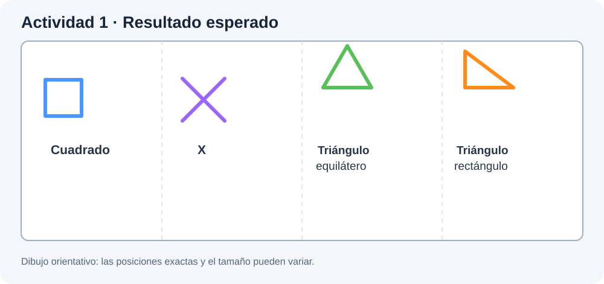
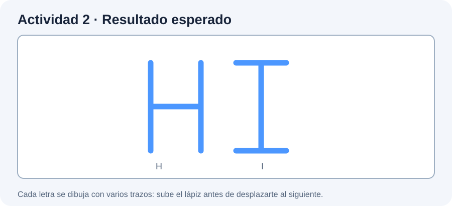
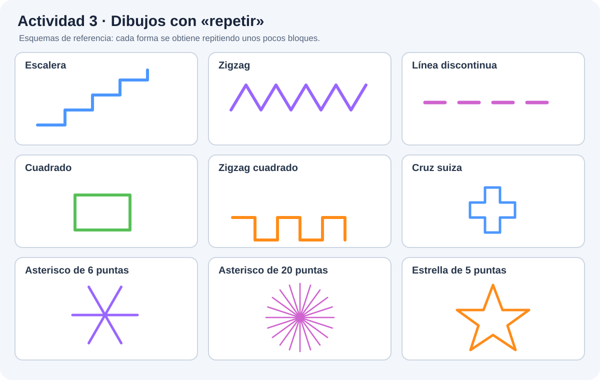

# Guía paso a paso: primeras actividades con el lápiz

En estas actividades usarás la extensión **Lápiz** de Scratch para dibujar en el escenario. Ve paso a paso y prueba el programa al terminar cada parte.

## Antes de empezar: añadir la extensión Lápiz

1. Abre tu proyecto de Scratch y selecciona el objeto que vas a programar, por ejemplo, el gato.
2. En la parte inferior izquierda, pulsa el botón **Añadir extensión**. Suele tener un símbolo de pieza de puzle.
3. Elige la extensión **Lápiz**.
4. Aparecerá una nueva categoría de bloques llamada **Lápiz**.
5. En la categoría **Lápiz**, localiza estos bloques:
   - **Borrar todo**: elimina los trazos anteriores del escenario.
   - **Bajar lápiz**: permite dibujar mientras se mueve el objeto.
   - **Subir lápiz**: permite mover el objeto sin dibujar.

> Si al pulsar la bandera verde no ves al personaje, puede haberse escondido detrás de un dibujo o haber salido del escenario. Los trazos del lápiz quedan en el escenario, no en el disfraz del personaje.

### ¿Cómo funciona el lápiz?

- El objeto que tiene el lápiz funciona como la punta de un lápiz.
- Si el lápiz está **bajado**, el objeto deja un trazo al moverse.
- Si el lápiz está **subido**, el objeto se desplaza sin dejar trazo.
- El bloque **ir a x: ... y: ...** coloca el objeto en un punto. Con el lápiz bajado, dibuja una línea hasta ese punto.
- En el escenario, el centro es aproximadamente **x: 0, y: 0**. Los valores de x van de -240 a 240 y los de y de -180 a 180.

## Actividad 1: dibujar cuatro figuras

Vamos a dibujar un cuadrado, una X, un triángulo equilátero y un triángulo rectángulo. Los haremos en un mismo programa y en lugares diferentes del escenario.



### Paso 1: preparar el programa

1. Selecciona el objeto que usará el lápiz.
2. En **Eventos**, arrastra **al presionar bandera verde** a la zona de programación.
3. Debajo, añade **borrar todo**, de la categoría **Lápiz**.
4. Añade **subir lápiz**. Así empezamos sin dibujar accidentalmente al colocar el objeto.
5. Desde **Movimiento**, añade **ir a x: -210 y: 100**.
6. Añade **apuntar en dirección 90**. Así sabemos que el objeto empieza mirando hacia la derecha.
7. Añade **bajar lápiz**.

El principio del programa queda así:

```text
al presionar bandera verde
borrar todo
subir lápiz
ir a x: -210 y: 100
apuntar en dirección 90
bajar lápiz
```

### Paso 2: dibujar el cuadrado

1. Desde **Control**, arrastra **repetir 4** debajo de **bajar lápiz**.
2. Dentro del hueco de **repetir 4**, coloca:
   - **mover 60 pasos**, de **Movimiento**.
   - **girar a la derecha 90 grados**, también de **Movimiento**.

El cuadrado tiene cuatro lados. Después de cada lado giramos 90 grados para empezar el siguiente.

```text
repetir 4
    mover 60 pasos
    girar a la derecha 90 grados
```

**Prueba:** pulsa la bandera verde. Deberías ver un cuadrado. Si solo ves una línea, revisa que los dos bloques estén dentro de **repetir 4**.

### Paso 3: dibujar la X

Para dibujar la segunda diagonal hay que mover el objeto sin dibujar hasta el otro extremo.

1. Añade **subir lápiz**.
2. Añade **ir a x: -100 y: 100**.
3. Añade **bajar lápiz** y luego **ir a x: -20 y: 20**. Ya tienes una diagonal.
4. Añade **subir lápiz**.
5. Añade **ir a x: -100 y: 20**.
6. Añade **bajar lápiz** y luego **ir a x: -20 y: 100**. Ya tienes la otra diagonal.
7. Añade **subir lápiz** para dejarlo preparado para desplazarse a la figura siguiente.

```text
subir lápiz
ir a x: -100 y: 100
bajar lápiz
ir a x: -20 y: 20
subir lápiz
ir a x: -100 y: 20
bajar lápiz
ir a x: -20 y: 100
subir lápiz
```

**Comprueba:** las dos líneas deben cruzarse. Si aparece una línea que une las diagonales por el borde, faltó subir el lápiz antes del segundo desplazamiento.

### Paso 4: dibujar el triángulo equilátero

Un triángulo equilátero tiene tres lados iguales. Al dibujarlo, giramos 120 grados en cada esquina.

1. Añade **ir a x: 30 y: 100**. El lápiz debe seguir **subido**.
2. Añade **apuntar en dirección 90**.
3. Añade **bajar lápiz**.
4. Desde **Control**, añade **repetir 3**.
5. Dentro del bloque, coloca **mover 80 pasos** y **girar a la izquierda 120 grados**, en ese orden.
6. Al terminar el bloque, añade **subir lápiz**.

```text
ir a x: 30 y: 100
apuntar en dirección 90
bajar lápiz
repetir 3
    mover 80 pasos
    girar a la izquierda 120 grados
subir lápiz
```

**Comprueba:** deben verse tres lados iguales. Si el triángulo no se cierra, revisa que el giro sea a la izquierda, de 120 grados, y que se repita 3 veces.

### Paso 5: dibujar el triángulo rectángulo

Usaremos tres puntos del escenario para dibujar los tres lados. En el primer vértice, un lado es horizontal y el otro vertical: forman un ángulo recto.

1. Asegúrate de que el lápiz está **subido**.
2. Añade **ir a x: 125 y: 100**.
3. Añade **bajar lápiz**.
4. Añade, en este orden, estos bloques de **Movimiento**:
   - **ir a x: 205 y: 100**
   - **ir a x: 125 y: 40**
   - **ir a x: 125 y: 100**
5. Añade **subir lápiz**.

```text
subir lápiz
ir a x: 125 y: 100
bajar lápiz
ir a x: 205 y: 100
ir a x: 125 y: 40
ir a x: 125 y: 100
subir lápiz
```

La primera línea es horizontal, la segunda es diagonal y la tercera es vertical. El último movimiento vuelve al punto de inicio y cierra el triángulo.

### Programa completo de la actividad 1

Lee el programa de arriba abajo. Los bloques de cada figura se añaden uno después de otro, debajo del anterior:

```text
al presionar bandera verde
borrar todo
subir lápiz
ir a x: -210 y: 100
apuntar en dirección 90
bajar lápiz
repetir 4
    mover 60 pasos
    girar a la derecha 90 grados
subir lápiz
ir a x: -100 y: 100
bajar lápiz
ir a x: -20 y: 20
subir lápiz
ir a x: -100 y: 20
bajar lápiz
ir a x: -20 y: 100
subir lápiz
ir a x: 30 y: 100
apuntar en dirección 90
bajar lápiz
repetir 3
    mover 80 pasos
    girar a la izquierda 120 grados
subir lápiz
ir a x: 125 y: 100
bajar lápiz
ir a x: 205 y: 100
ir a x: 125 y: 40
ir a x: 125 y: 100
subir lápiz
```

> Los bloques que aparecen dentro de **repetir** deben encajarse en su hueco. Los bloques que aparecen después del bloque de repetición van debajo de este, no dentro.

## Actividad 2: escribir HI con el lápiz

Ahora dibujaremos las letras **H** e **I** con líneas rectas. Para cambiar de trazo sin dibujar, subiremos el lápiz y lo bajaremos en el punto siguiente.



### Paso 1: empezar en limpio

1. Crea un proyecto nuevo o borra los bloques de la actividad anterior.
2. Comprueba que la extensión **Lápiz** está añadida.
3. Añade **al presionar bandera verde**, de **Eventos**.
4. Debajo, añade **borrar todo** y **subir lápiz**.

### Paso 2: dibujar la H

La H tiene dos líneas verticales y una línea horizontal entre ellas.

1. Añade **ir a x: -50 y: 45**.
2. Añade **bajar lápiz** y luego **ir a x: -50 y: -45**. Es la primera línea vertical.
3. Añade **subir lápiz** y luego **ir a x: -50 y: 0**.
4. Añade **bajar lápiz** y luego **ir a x: 0 y: 0**. Es la línea horizontal del centro.
5. Añade **subir lápiz** y luego **ir a x: 0 y: 45**.
6. Añade **bajar lápiz** y luego **ir a x: 0 y: -45**. Es la segunda línea vertical.
7. Añade **subir lápiz**.

```text
ir a x: -50 y: 45
bajar lápiz
ir a x: -50 y: -45
subir lápiz
ir a x: -50 y: 0
bajar lápiz
ir a x: 0 y: 0
subir lápiz
ir a x: 0 y: 45
bajar lápiz
ir a x: 0 y: -45
subir lápiz
```

### Paso 3: dibujar la I

La I se formará con una línea vertical y dos líneas horizontales, una arriba y otra abajo.

1. Añade **ir a x: 55 y: 45**.
2. Añade **bajar lápiz** y luego **ir a x: 55 y: -45**. Esta es la línea vertical.
3. Añade **subir lápiz** y luego **ir a x: 30 y: 45**.
4. Añade **bajar lápiz** y luego **ir a x: 80 y: 45**. Esta es la línea superior.
5. Añade **subir lápiz** y luego **ir a x: 30 y: -45**.
6. Añade **bajar lápiz** y luego **ir a x: 80 y: -45**. Esta es la línea inferior.
7. Termina con **subir lápiz**.

```text
ir a x: 55 y: 45
bajar lápiz
ir a x: 55 y: -45
subir lápiz
ir a x: 30 y: 45
bajar lápiz
ir a x: 80 y: 45
subir lápiz
ir a x: 30 y: -45
bajar lápiz
ir a x: 80 y: -45
subir lápiz
```

### Programa completo de la actividad 2

```text
al presionar bandera verde
borrar todo
subir lápiz
ir a x: -50 y: 45
bajar lápiz
ir a x: -50 y: -45
subir lápiz
ir a x: -50 y: 0
bajar lápiz
ir a x: 0 y: 0
subir lápiz
ir a x: 0 y: 45
bajar lápiz
ir a x: 0 y: -45
subir lápiz
ir a x: 55 y: 45
bajar lápiz
ir a x: 55 y: -45
subir lápiz
ir a x: 30 y: 45
bajar lápiz
ir a x: 80 y: 45
subir lápiz
ir a x: 30 y: -45
bajar lápiz
ir a x: 80 y: -45
subir lápiz
```

## Si algo no sale

- **No aparece ningún dibujo:** comprueba que has seleccionado un objeto, añadido la extensión Lápiz y conectado los bloques debajo del evento.
- **El objeto se mueve, pero no dibuja:** comprueba que el lápiz está bajado antes del movimiento.
- **Aparecen líneas que no querías:** sube el lápiz antes de mover el objeto hasta el siguiente punto.
- **Las figuras se dibujan encima unas de otras:** revisa las coordenadas de inicio de cada figura.
- **El cuadrado no se cierra:** revisa que se repite 4 veces y que el giro es de 90 grados.
- **El triángulo equilátero no se cierra:** revisa que se repite 3 veces y que el giro es de 120 grados.
- **Los trazos anteriores siguen en la pantalla:** comprueba que **borrar todo** está al principio del programa.

## Comprueba tu trabajo

- [ ] He añadido la extensión Lápiz.
- [ ] La actividad 1 dibuja las cuatro figuras.
- [ ] La actividad 2 muestra las letras HI.
- [ ] He usado **subir lápiz** para moverme sin dibujar.
- [ ] He guardado mi proyecto.

---

## Actividad 3: repetir para dibujar patrones

En esta actividad aprenderás a usar el bloque **repetir**. En lugar de colocar muchas veces las mismas instrucciones, las escribimos una vez dentro del bloque y le decimos cuántas veces queremos repetirlas.



### Antes de empezar

1. Selecciona el objeto que dibuja y comprueba que tiene la extensión **Lápiz**.
2. Cada dibujo de esta actividad es un programa diferente. Para probarlos, puedes dejar solo un programa conectado a **al presionar bandera verde** cada vez.
3. Al principio de cada programa, coloca **borrar todo**, **subir lápiz** y la posición indicada.
4. Antes de empezar cada figura, usa **apuntar en dirección** para colocar el objeto en la dirección indicada.
5. Si un dibujo queda demasiado grande, reduce el número de pasos. Si queda pequeño, auméntalo.

> Si dejas todos los programas unidos a la bandera verde, se ejecutarán a la vez. Para evitarlo, prueba un dibujo cada vez: desconecta los otros bloques o inicia cada dibujo con una tecla diferente.

### ¿Qué hace «repetir»?

El bloque **repetir 4** ejecuta cuatro veces todos los bloques que están dentro de su hueco.

```text
repetir 4
    mover 50 pasos
    girar a la derecha 90 grados
```

El programa hace cuatro veces: avanzar y girar. Observa que **mover** y **girar** están dentro de **repetir**. Si quedan fuera, no se repetirán.

### 1. Dibujar una escalera

En cada escalón, el objeto avanza en horizontal y luego baja un poco. Se repiten los mismos dos movimientos.

1. Añade **apuntar en dirección 90**.
2. Coloca un bloque **repetir 5**.
3. Dentro añade:
   - **mover 30 pasos**
   - **girar a la derecha 90 grados**
   - **mover 20 pasos**
   - **girar a la izquierda 90 grados**

```text
apuntar en dirección 90
repetir 5
    mover 30 pasos
    girar a la derecha 90 grados
    mover 20 pasos
    girar a la izquierda 90 grados
```

Al terminar cada repetición, el objeto vuelve a mirar hacia la derecha y empieza el siguiente escalón.

### 2. Dibujar un zigzag

Para formar picos iguales, el objeto alternará dos direcciones diagonales. Antes de repetir, lo colocamos mirando en diagonal.

1. Añade **apuntar en dirección 45**.
2. Coloca **repetir 6**.
3. Dentro añade:
   - **mover 30 pasos**
   - **girar a la derecha 90 grados**
   - **mover 30 pasos**
   - **girar a la izquierda 90 grados**

```text
apuntar en dirección 45
repetir 6
    mover 30 pasos
    girar a la derecha 90 grados
    mover 30 pasos
    girar a la izquierda 90 grados
```

Los giros hacen que cada pareja de líneas forme un pico y una hendidura.

### 3. Dibujar una línea discontinua

En una línea discontinua alternamos un tramo dibujado y un espacio sin dibujar.

1. Añade **apuntar en dirección 90**.
2. Añade **bajar lápiz**.
3. Coloca **repetir 8**.
4. Dentro añade, en este orden:
   - **mover 20 pasos**
   - **subir lápiz**
   - **mover 15 pasos**
   - **bajar lápiz**

```text
apuntar en dirección 90
bajar lápiz
repetir 8
    mover 20 pasos
    subir lápiz
    mover 15 pasos
    bajar lápiz
```

**Importante:** subir el lápiz crea el espacio; bajarlo al final prepara el siguiente tramo.

### 4. Dibujar un cuadrado

Un cuadrado tiene cuatro lados iguales y cuatro giros de 90 grados.

1. Añade **apuntar en dirección 90**.
2. Añade **bajar lápiz**.
3. Coloca **repetir 4** con estos bloques dentro:
   - **mover 60 pasos**
   - **girar a la derecha 90 grados**

```text
apuntar en dirección 90
bajar lápiz
repetir 4
    mover 60 pasos
    girar a la derecha 90 grados
```

### 5. Dibujar un zigzag cuadrado

Este patrón tiene esquinas rectas. En cada repetición, el objeto avanza, gira a la derecha, avanza y gira a la izquierda. Así, la segunda línea cambia de orientación y el recorrido parece una escalera cuadrada. Al repetir dos veces hay dos giros a la derecha y dos a la izquierda.

1. Añade **apuntar en dirección 90**.
2. Coloca **repetir 2**.
3. Dentro añade:
   - **mover 40 pasos**
   - **girar a la derecha 90 grados**
   - **mover 40 pasos**
   - **girar a la izquierda 90 grados**

```text
apuntar en dirección 90
repetir 2
    mover 40 pasos
    girar a la derecha 90 grados
    mover 40 pasos
    girar a la izquierda 90 grados
```

Este patrón de escalones no es un cuadrado cerrado: el nombre se refiere a sus giros en ángulo recto.

### 6. Dibujar una cruz suiza

Vamos a dibujar el **contorno** de una cruz como la de las farmacias: tiene cuatro brazos anchos y queda vacía por dentro. La recorreremos por fuera, dibujando tres lados en cada repetición.

1. Añade **subir lápiz**, **ir a x: -20 y: -60** y **apuntar en dirección 90**.
2. Añade **bajar lápiz** para empezar a dibujar el contorno.
3. Coloca **repetir 4**.
4. Dentro añade, en este orden:
   - **mover 40 pasos**
   - **girar a la izquierda 90 grados**
   - **mover 40 pasos**
   - **girar a la derecha 90 grados**
   - **mover 40 pasos**
   - **girar a la izquierda 90 grados**
5. Debajo de **repetir**, añade **subir lápiz**.

```text
subir lápiz
ir a x: -20 y: -60
apuntar en dirección 90
bajar lápiz
repetir 4
    mover 40 pasos
    girar a la izquierda 90 grados
    mover 40 pasos
    girar a la derecha 90 grados
    mover 40 pasos
    girar a la izquierda 90 grados
subir lápiz
```

**Comprueba:** debe aparecer una cruz cerrada, con el interior vacío. Si no se cierra, revisa el orden de los tres giros: izquierda, derecha e izquierda.

### 7. Dibujar un asterisco de 6 puntas

Dibujaremos seis brazos desde el centro. Cada vez giramos 60 grados para colocar el siguiente brazo.

1. Añade **ir a x: 0 y: 0** y **apuntar en dirección 90**.
2. Añade **bajar lápiz**.
3. Coloca **repetir 6**.
4. Dentro añade:
   - **mover 50 pasos**
   - **subir lápiz**
   - **mover -50 pasos** para volver al centro
   - **bajar lápiz**
   - **girar a la derecha 60 grados**

```text
ir a x: 0 y: 0
apuntar en dirección 90
bajar lápiz
repetir 6
    mover 50 pasos
    subir lápiz
    mover -50 pasos
    bajar lápiz
    girar a la derecha 60 grados
```

Cada repetición dibuja un brazo. Como 6 × 60° = 360°, al final habremos dado una vuelta completa.

### 8. Dibujar un asterisco de 20 puntas

Usamos la misma idea, pero hacemos veinte brazos y giramos menos en cada uno.

1. Añade **ir a x: 0 y: 0** y **apuntar en dirección 90**.
2. Añade **bajar lápiz**.
3. Coloca **repetir 20**.
4. Dentro añade:
   - **mover 50 pasos**
   - **subir lápiz**
   - **mover -50 pasos**
   - **bajar lápiz**
   - **girar a la derecha 18 grados**

```text
ir a x: 0 y: 0
apuntar en dirección 90
bajar lápiz
repetir 20
    mover 50 pasos
    subir lápiz
    mover -50 pasos
    bajar lápiz
    girar a la derecha 18 grados
```

Cada giro es de 18° porque 360° ÷ 20 = 18°.

### 9. Dibujar una estrella de 5 puntas

Esta estrella se dibuja con una línea continua. Cada vez que avanzamos, giramos 144 grados.

1. Añade **apuntar en dirección 90**.
2. Añade **bajar lápiz**.
3. Coloca **repetir 5**.
4. Dentro añade:
   - **mover 100 pasos**
   - **girar a la derecha 144 grados**

```text
apuntar en dirección 90
bajar lápiz
repetir 5
    mover 100 pasos
    girar a la derecha 144 grados
```

**Comprueba:** la línea debe cruzarse en el centro y formar una estrella. Si solo sale un pentágono, revisa que el giro sea de 144 grados.

## Si un dibujo sale distinto

- **Solo aparece una línea:** asegúrate de que **mover** y **girar** están dentro del bloque **repetir**.
- **El patrón no tiene esquinas:** revisa que los giros tienen los grados indicados.
- **La línea discontinua queda entera:** comprueba que **subir lápiz** y **bajar lápiz** están dentro de la repetición y en el orden correcto.
- **Los brazos del asterisco no salen del mismo centro:** vuelve al centro con el lápiz subido antes de girar.
- **La cruz no se cierra:** revisa que los tres movimientos y los tres giros estén dentro de **repetir 4** y sigan el orden indicado.
- **El dibujo se sale del escenario:** reduce los pasos o empieza en una posición más cercana al centro.
- **Se mezclan varios dibujos:** prueba solo un programa de bandera verde cada vez.

## Comprueba tu trabajo

- [ ] He usado **repetir** en mis dibujos.
- [ ] He dibujado la escalera, el zigzag y la línea discontinua.
- [ ] He dibujado el cuadrado y el zigzag cuadrado.
- [ ] He dibujado la cruz suiza y los dos asteriscos.
- [ ] He dibujado la estrella de 5 puntas.
- [ ] He guardado el proyecto.

---

## Actividad 4: tres personajes hacen cosas diferentes

En esta actividad crearás una pequeña escena con **tres personajes**. Cada uno tendrá su propio programa:

1. El primer personaje dirá «Hola» y cambiará de tamaño **al pulsar la bandera verde**.
2. El segundo pensará «¿Quién es?» y se moverá **al pulsar la tecla espacio**.
3. El tercero cambiará de disfraz y emitirá un sonido **al hacer clic sobre él**.

Así practicarás tres eventos diferentes para iniciar programas. No hace falta usar la extensión Lápiz en esta actividad.

### Paso 1: preparar el escenario y los personajes

1. Crea un proyecto nuevo en Scratch.
2. Puedes conservar el personaje que aparece al comenzar o elegir otro.
3. Pulsa **Elegir un objeto**, en la parte inferior derecha, y añade un segundo personaje.
4. Repite el paso anterior para añadir un tercer personaje.
5. Arrastra los tres personajes sobre el escenario para colocarlos separados. Así podrás verlos bien.
6. Elige un fondo si te apetece.

**Comprueba:** en la lista de objetos aparecen tres personajes. Puedes escoger los que más te gusten.

> **Importante:** antes de programar, haz clic en el personaje correspondiente en la lista de objetos. Cada personaje tiene sus propios bloques.

### Paso 2: el primer personaje saluda y cambia de tamaño

1. Selecciona el **primer personaje**.
2. Abre la pestaña **Código**.
3. En **Eventos**, arrastra **al presionar bandera verde**.
4. En **Apariencia**, añade **fijar tamaño a 100 %**. Así empezará siempre con el mismo tamaño.
5. Añade **decir [Hola] durante 2 segundos** y escribe `Hola` en el hueco.
6. Añade **cambiar tamaño por 30**.

```text
al presionar bandera verde
fijar tamaño a 100 %
decir [Hola] durante 2 segundos
cambiar tamaño por 30
```

**Prueba:** pulsa la bandera verde. El personaje dice «Hola» y, después de dos segundos, se hace más grande. Si quieres que se haga más pequeño, utiliza un número negativo, por ejemplo, `-30`.

### Paso 3: el segundo personaje piensa y se mueve

1. Selecciona el **segundo personaje** en la lista de objetos.
2. En **Eventos**, arrastra **al presionar tecla [espacio]**. Si aparece otra tecla en el bloque, abre el desplegable y elige **espacio**.
3. En **Apariencia**, añade **pensar [¿Quién es?] durante 2 segundos** y escribe `¿Quién es?`.
4. En **Movimiento**, añade **apuntar en dirección 90** para que se mueva hacia la derecha.
5. Añade **mover 50 pasos**.

```text
al presionar tecla [espacio]
pensar [¿Quién es?] durante 2 segundos
apuntar en dirección 90
mover 50 pasos
```

**Prueba:** haz clic en un espacio vacío del escenario y pulsa la tecla **espacio**. El segundo personaje muestra un bocadillo de pensamiento y, después de dos segundos, se desplaza hacia la derecha. Si llega al borde, arrástralo hacia el centro antes de probar de nuevo.

### Paso 4: preparar los disfraces y el sonido del tercer personaje

1. Selecciona el **tercer personaje**.
2. Abre la pestaña **Disfraces**. Comprueba que tiene al menos **dos disfraces diferentes**.
3. Si solo tiene uno, usa **Elegir un disfraz** para añadir otro. También puedes duplicar el primero y modificarlo para que se vea diferente.
4. Abre la pestaña **Sonidos** y comprueba que tiene al menos un sonido.
5. Si no tiene ninguno, pulsa **Elegir un sonido** y añade el que prefieras.

**Recuerda:** los disfraces son apariencias del mismo personaje; no son personajes nuevos.

### Paso 5: el tercer personaje cambia de disfraz y emite un sonido

1. Con el **tercer personaje** seleccionado, vuelve a **Código**.
2. En **Eventos**, añade **al hacer clic en este objeto**.
3. En **Apariencia**, añade **siguiente disfraz**.
4. En **Sonido**, añade **tocar sonido [sonido] hasta que termine**. En el menú del bloque, elige el sonido que has preparado.

```text
al hacer clic en este objeto
siguiente disfraz
tocar sonido [elige tu sonido] hasta que termine
```

**Prueba:** haz clic directamente sobre el tercer personaje **en el escenario**: cambia de aspecto y reproduce el sonido. Si vuelves a hacer clic, pasará al siguiente disfraz disponible.

### Paso 6: probar los tres eventos

1. Pulsa la **bandera verde**: el primer personaje dice «Hola» y cambia de tamaño.
2. Pulsa la tecla **espacio**: el segundo piensa «¿Quién es?» y se mueve.
3. Haz clic sobre el **tercer personaje en el escenario**: cambia de disfraz y reproduce el sonido.
4. Comprueba que cada personaje tiene su evento y sus instrucciones conectadas debajo. La bandera no inicia los otros dos programas: cada uno espera su propio evento.
5. Pulsa el botón rojo para detener los programas que estén en marcha y guarda tu trabajo.

### Si algo no sale

- **Un personaje no hace nada:** selecciónalo y comprueba que sus bloques están unidos al evento correcto. Pulsa la bandera para el primero, espacio para el segundo y haz clic en el tercero.
- **La tecla espacio no funciona:** haz clic en un espacio vacío del escenario y vuelve a pulsarla. Comprueba también que el bloque de evento tiene seleccionada la tecla **espacio**.
- **Al seleccionar el tercer personaje no ocurre nada:** haz clic sobre el personaje en el escenario, no solo en su miniatura de la lista de objetos.
- **Hace las acciones otro personaje:** revisa en qué objeto has colocado el programa. Selecciona el personaje correcto antes de añadir sus bloques.
- **El primer personaje crece cada vez más:** comprueba que **fijar tamaño a 100 %** está antes del bloque que cambia su tamaño.
- **El segundo personaje no parece moverse:** revisa que **mover 50 pasos** está conectado y que tiene espacio libre a la derecha.
- **El tercer personaje no parece cambiar:** necesita al menos dos disfraces distintos. Revísalos en la pestaña **Disfraces**.
- **No se oye el sonido:** comprueba que el personaje tiene un sonido seleccionado en el bloque y que el volumen del dispositivo está activado.

### Comprueba tu trabajo

- [ ] Tengo tres personajes en el escenario.
- [ ] El primero dice «Hola» y cambia de tamaño al pulsar la bandera verde.
- [ ] El segundo piensa «¿Quién es?» y se mueve al pulsar espacio.
- [ ] El tercero cambia de disfraz y reproduce un sonido al hacer clic sobre él.
- [ ] He usado tres eventos diferentes, uno para cada personaje.
- [ ] He guardado el proyecto.
