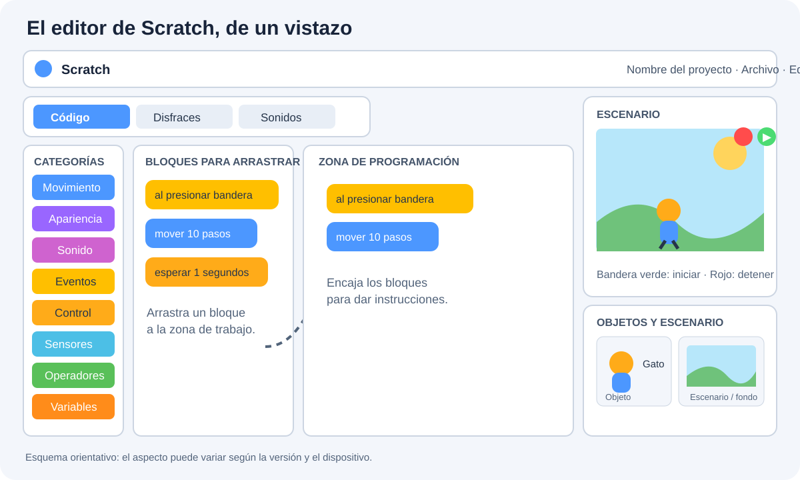
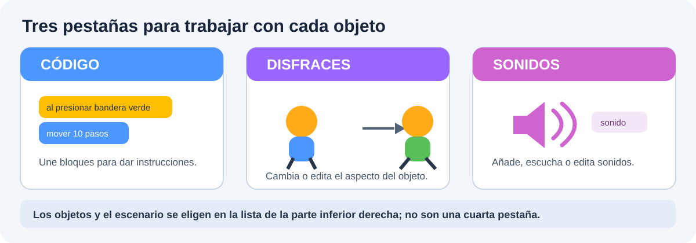
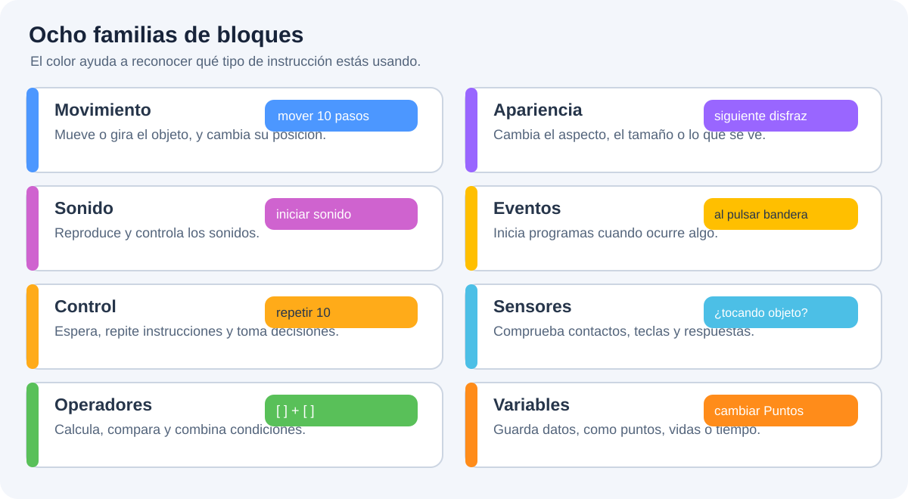

# Conoce el editor de Scratch

## ¿Qué es Scratch?

Scratch es un entorno para crear historias, animaciones y videojuegos dando instrucciones con bloques. En vez de escribir código con el teclado, arrastras los bloques y los encajas como piezas de un puzle.

En esta guía conocerás las partes del editor y los bloques que hemos visto en clase. Los dibujos son esquemas simplificados del editor: pueden cambiar un poco de aspecto según la versión o el tamaño de la pantalla.

## 1. Vista general del editor



### Las zonas principales

1. **Barra superior:** permite cambiar el nombre del proyecto y encontrar opciones como abrirlo o guardarlo.
2. **Pestañas Código, Disfraces y Sonidos:** sirven para programar un objeto y cambiar su aspecto o sus sonidos.
3. **Categorías de bloques:** agrupan las instrucciones por tipo y color.
4. **Paleta de bloques:** muestra los bloques de la categoría seleccionada. Desde aquí los arrastras.
5. **Zona de programación:** aquí unes los bloques para crear instrucciones.
6. **Escenario:** es la pantalla donde se ve la historia o el juego. La bandera verde inicia los programas y el botón rojo los detiene.
7. **Lista de objetos y escenario:** permite seleccionar un personaje u objeto, o seleccionar el escenario para cambiar sus fondos y programarlo.
8. **Información del objeto:** muestra datos como su nombre, posición, tamaño y dirección.

### Una idea importante: objeto y escenario

- Un **objeto** es un personaje o elemento que puede tener programas, disfraces y sonidos. Por ejemplo, un gato, una pelota o una estrella.
- El **escenario** es el espacio donde aparecen los objetos. Sus imágenes de fondo se llaman **fondos**.
- Si seleccionas un objeto, puedes programarlo y cambiar sus disfraces o sonidos.
- Si seleccionas el escenario, puedes programar lo que ocurre en él y cambiar sus fondos. El escenario no tiene disfraces como los objetos, pero sí tiene fondos.

## 2. Las tres pestañas



### Código

Aquí construyes los programas. Elige una categoría, arrastra un bloque a la zona de programación y únelo con otros bloques.

**Ejemplo:** `al presionar bandera verde` + `mover 10 pasos`. Al pulsar la bandera verde, el objeto avanza.

### Disfraces

Un disfraz es una apariencia distinta del mismo objeto. Puedes elegir otro disfraz, dibujar uno o editarlo. Cambiar de disfraz no crea un objeto nuevo: el personaje sigue siendo el mismo.

**Ejemplo:** un personaje tiene un disfraz con las piernas juntas y otro con las piernas separadas. Al alternarlos, parece que camina.

### Sonidos

Aquí puedes escuchar, añadir, grabar o editar sonidos de ese objeto. También puedes programar cuándo se reproducen desde la pestaña **Código**, usando los bloques de sonido.

**Ejemplo:** añadir un sonido de salto al personaje y programar que suene cuando se pulse una tecla.

## 3. Las categorías de bloques



Los bloques tienen colores para que sea más fácil reconocer su función. Un programa suele empezar con un evento, puede usar bloques de control y luego realizar acciones. También puede comprobar sensores y utilizar operadores o variables.

### Movimiento: mover y colocar objetos

Los bloques de movimiento cambian la posición o la dirección de un objeto. Solo aparecen cuando seleccionas un objeto; el escenario no se mueve.

- **Mover 10 pasos:** mueve el objeto hacia donde está apuntando. Si apunta a la derecha, avanza hacia la derecha.
- **Girar 15 grados:** cambia la dirección hacia la que apunta.
- **Ir a x: 0 y: 0:** coloca el objeto en un punto concreto del escenario.
- **Cambiar x por 10:** desplaza el objeto horizontalmente. Un número positivo lo mueve a la derecha y uno negativo, a la izquierda.
- **Cambiar y por 10:** desplaza el objeto verticalmente. Un número positivo lo mueve hacia arriba y uno negativo, hacia abajo.

**Prueba a pensar:** si un objeto apunta hacia abajo, ¿hacia dónde se moverá al ejecutar **mover 10 pasos**?

### Apariencia: cambiar lo que se ve

Estos bloques cambian lo que se ve en el escenario: el disfraz, el tamaño, los bocadillos o la visibilidad.

- **Decir “¡Hola!” por 2 segundos:** muestra un bocadillo durante un tiempo.
- **Cambiar disfraz a...** o **siguiente disfraz:** cambia la apariencia del objeto.
- **Cambiar tamaño por 10:** hace el objeto un poco más grande; con un número negativo, más pequeño.
- **Mostrar** y **esconder:** hacen que el objeto aparezca o desaparezca.
- En el **escenario**, los bloques de apariencia pueden cambiar el fondo.

**Ejemplo:** cambia de disfraz cada vez que el personaje se mueve para simular que camina.

### Sonido: añadir sonidos

Estos bloques reproducen y controlan sonidos del objeto seleccionado.

- **Iniciar sonido [sonido]:** empieza a reproducir un sonido y el programa puede continuar.
- **Tocar sonido [sonido] hasta que termine:** reproduce el sonido entero antes de continuar con el siguiente bloque.
- **Detener todos los sonidos:** para los sonidos que se están reproduciendo.
- **Cambiar volumen por 10:** sube o baja el volumen.

**Ejemplo:** al pulsar una tecla, iniciar el sonido de salto.

### Eventos: decidir cuándo empieza un programa

Los eventos son bloques que inician un conjunto de instrucciones. Suelen tener la parte superior redondeada y se colocan al principio.

- **Al presionar bandera verde:** inicia el programa al comenzar el proyecto.
- **Al presionar tecla [espacio]:** inicia el programa cuando se pulsa una tecla.
- **Al hacer clic en este objeto:** inicia el programa al hacer clic sobre el objeto.
- **Al recibir [mensaje]:** inicia el programa cuando otro programa envía ese mensaje.

**Ejemplo:** `al presionar tecla [espacio]` + `decir “¡Salto!”`. El personaje habla cuando pulsas espacio.

### Control: repetir y decidir

Estos bloques organizan el orden y las repeticiones de las instrucciones.

- **Esperar 1 segundos:** hace una pausa.
- **Repetir 10:** repite las instrucciones de su interior 10 veces.
- **Por siempre:** repite las instrucciones de su interior hasta que se detenga el programa.
- **Si... entonces:** ejecuta lo que hay dentro solo si se cumple una condición.
- **Si... entonces... si no:** permite hacer una cosa si se cumple la condición y otra si no se cumple.

**Ejemplo:** `por siempre` + `mover 10 pasos` hace que el objeto avance repetidamente.

> Los bloques que repiten tienen una abertura donde se colocan los bloques que quieres repetir.

### Sensores: preguntar qué está ocurriendo

Los sensores permiten que el programa detecte cosas, como si un objeto toca a otro o si se ha pulsado una tecla.

- **¿Tocando [objeto]?:** comprueba si el objeto está tocando otro objeto o el puntero del ratón.
- **¿Tecla [espacio] presionada?:** comprueba si se está pulsando una tecla.
- **Preguntar [¿Cómo te llamas?] y esperar:** muestra una pregunta y espera una respuesta.
- **Respuesta:** contiene lo que se contestó a la pregunta.
- **Cronómetro:** mide el tiempo desde que se reinició.

**Ejemplo:** `si <¿tocando [pelota]?> entonces` puede hacer que el personaje diga algo al tocar la pelota.

### Operadores: calcular y comparar

Los operadores sirven para hacer operaciones, unir textos y comparar valores. Sus bloques suelen tener forma de óvalo o de rombo.

- **[ ] + [ ]:** suma dos números. También hay bloques para restar, multiplicar y dividir.
- **[ ] > [ ]**, **[ ] < [ ]** y **[ ] = [ ]:** comparan dos valores. El resultado es verdadero o falso.
- **[ ] y [ ]**, **[ ] o [ ]** y **no [ ]:** combinan o cambian condiciones.
- **Unir [hola] [mundo]:** junta dos textos.

**Ejemplo:** `si <Puntos > 4> entonces` permite hacer algo cuando la puntuación supera 4.

### Variables: guardar información

Una variable es como una cajita con nombre donde el programa guarda un dato. Ese dato puede cambiar mientras funciona el proyecto. Por ejemplo: puntos, vidas o tiempo.

- **Crear una variable:** le pone un nombre a la cajita, por ejemplo, `Puntos`.
- **Dar a [Puntos] el valor 0:** guarda un valor nuevo. Es útil para iniciar la partida.
- **Cambiar [Puntos] por 1:** suma 1 al valor que ya tenía.
- **Mostrar variable** y **esconder variable:** enseñan u ocultan su marcador en el escenario.

**Ejemplo:** al empezar, dar a `Puntos` el valor 0; cuando el personaje atrapa una estrella, cambiar `Puntos` por 1.

## 4. Cómo leer un programa

Lee los bloques de arriba abajo. Los bloques encajados debajo de otro se ejecutan después. Los bloques que están dentro de un bloque de control, como **repetir** o **si... entonces**, forman parte de esa repetición o condición.

```text
al presionar bandera verde
dar a [Puntos] el valor 0
por siempre
    si <¿tocando [estrella]?> entonces
        cambiar [Puntos] por 1
```

Este programa empieza al pulsar la bandera, pone la puntuación a cero y, repetidamente, comprueba si el objeto toca la estrella. Si la toca, suma un punto.

## 5. Recuerda

- Primero selecciona el objeto que quieres programar.
- **Código** sirve para programar; **Disfraces** para cambiar su aspecto; **Sonidos** para gestionar sus sonidos.
- Los bloques deben encajar y estar unidos para formar un programa.
- La bandera verde inicia los programas y el botón rojo los detiene.
- Prueba el proyecto a menudo. Si algo no sale como esperabas, revisa los bloques desde arriba.

Para practicar estos bloques creando un juego, puedes seguir la [guía paso a paso de Pong](./Guia-Pong-Scratch.md).
